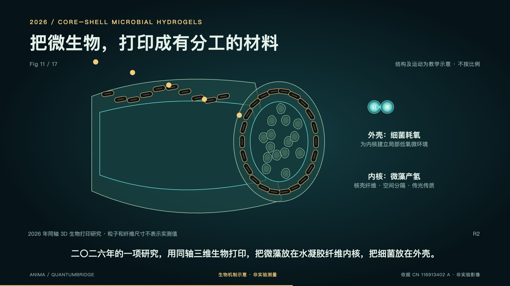
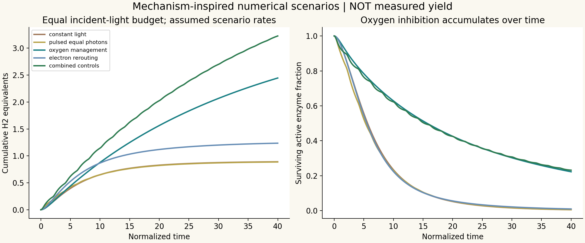
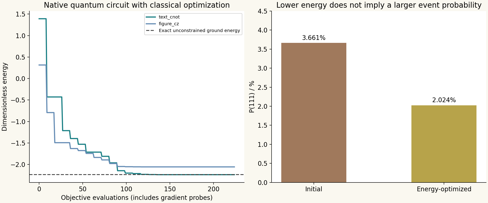

# 一束光如何成为氢气：把生物能源写成可验证的计算

作者：曾祥洪 --QuantumBridge研发组

**QuantumBridge 产品深读系列 · 生物光制氢**

太阳照进培养液时，真正决定氢气能否持续生成的，远不止光有多亮。电子可能流向碳同化，氧气可能使氢酶失活，传光与传质还会在尺度放大时重新划定边界。光带来可能，电子选择方向；催化打开路径，环境决定续航。

QuantumBridge 的这份案例把问题拆成三个可检查的层次：生物机制解释电子来自哪里，过程模型追踪电子如何分配，量子线路验证能量与测量事件之间的关系。Anima 则让这些结构、通量和约束进入同一个可操作的视觉空间。**让过程看得见，让结论算得清。**

本案例同时保留本地模拟和 8 个夸父 Baihua 真机任务的原始测量记录。动画呈现机制，数值来自公开代码；量子线路的硬件结果与培养体系的实验效果分别验证，后者仍需独立测量。

## 一 2026 年的前沿 已经从单点催化走向系统协同

2026 年一项整细胞研究关注蓝藻中的供电子能力、代谢分配与耗氧条件。其意义在于把氢酶放回细胞网络中考察：有催化酶，并不意味着电子一定到达；有电子，也不意味着氧环境允许它持续工作。**催化须与供给相连，活性须与环境相安。** [研究机构记录](https://www.ufz.de/index.php?en=20939&pub_id=33069)

另一条路线把空间结构变成控制变量。2026 年《Nature Communications》报道的核壳共生水凝胶，利用同轴三维生物打印，将微藻与细菌分置于内核和外壳，让局部耗氧与光利用共同服务于产氢。它是一种具体材料体系中的实验结果，不能将其产率直接移植到本案例的参数表。**空间可以组织代谢，材料也能调节边界。** [原始研究](https://www.nature.com/articles/s41467-026-70988-x)

半导体—微生物杂化体系则从界面进入。2026 年 ZnIn₂S₄ 与 Shewanella oneidensis 的研究考察光生电子如何影响细胞碳代谢及产氢；这类体系涉及有机底物与完整氧化还原收支，不能直接称为“仅靠水和阳光”的全水分解。**界面传递的是电荷，性能依赖的是全局。** [原始研究记录](https://pubmed.ncbi.nlm.nih.gov/41759980/)

这些方法不是可以任意拼接的零件。不同微生物、材料、电子供体与反应器条件，决定了不同的适用范围。本案例提取它们共同提出的研究问题：光照怎样组织，电子怎样分配，氧怎样管理；其余未经标定的细节，继续留在假设栏里。

*Anima 重新构建的教学示意，非论文原图、非等比例结构、非本项目装置实拍。图示依据上述核壳共生研究，不将不同技术路线解释为同一套已验证系统。*

## 二 从水到氢 必须先把电子的来路讲清

在所展示的衣藻通路中，光系统 II 的水氧化可向光合链补充电子；电子经载体传向光系统 I，再由还原型铁氧还蛋白向氢酶供给还原力。这里既有第二次光激发，也有竞争性的电子去路。**电子并非一路直达，产氢也非独占分支。** [水氧化与电子来源的实验研究](https://pmc.ncbi.nlm.nih.gov/articles/PMC7703569/)

两端的净反应计量可以写为：

$$
2H_2O\rightarrow O_2+4H^++4e^-,\qquad
2H^++2e^-\rightarrow H_2.
$$

这给计算提供了不能随意突破的账本：每形成一个氢分子，需要两个电子当量；由水氧化输入四个电子当量，对应一个氧分子的产生。实际过程还包含质子转运、跨膜梯度和多步酶催化，净计量并不等于完整反应机理。**粒子要守其数，机制要明其路。**

Anima 动画因此分别标记光能、电子、质子与氢分子，让观众能够暂停、放大并观察不同通路。粒子速度与出现数量用于讲述因果顺序，不编码真实浓度、反应速率或量子产率。

## 三 写下过程方程 才能检验控制策略

为了让“看见”进入“计算”，案例定义归一化电子库 $e$、氧状态 $o$、剩余活性氢酶分数 $a$ 与累计氢当量 $h$。供电子、氢酶分流、竞争去路与复合损失分别记作 $v_s,v_h,v_c,v_r$：

$$
\dot e=v_s-v_h-v_c-v_r,
\quad \dot o=\frac{v_s}{4}-k_o o,
\quad \dot a=-k_doa,
\quad \dot h=\frac{v_h}{2}.
$$

本次情景进一步采用：

$$
v_s=k_sL(t)(1-e),\qquad v_h=k_h\beta ae,
\qquad v_c=k_c(1-\beta)e,\qquad v_r=k_re.
$$

$\beta$ 控制流向氢酶的电子分配倾向，$k_o$ 控制去氧，$k_d$ 描述氧相关失活。所有系数都是公开记录的作者情景设定，没有从上述论文拟合；时间与氢当量均为归一化量。模型还简化掉真实酶的合成、修复和多尺度传质，不能把结果换算成毫升、小时或工程效率。**参数写在明处，推论停在据处。**

模型同时累计输入电子 $Q_s$、竞争消耗 $Q_c$、复合损失 $Q_r$ 和移除氧量 $O_{\mathrm{out}}$。从空电子库与零初始产物出发，应始终满足：

$$
Q_s=e+2h+Q_c+Q_r,\qquad
\frac{Q_s}{4}=o+O_{\mathrm{out}}.
$$

这些等式使“验证”有了具体对象。积分器即便给出一条漂亮曲线，只要电子或氧的收支不闭合，结果就应被拒绝。程序还在脉冲开闭点分段积分，以免短脉冲被求解步长跨过。**曲线可以悦目，守恒必须成立。**

## 四 结果并不迎合口号 脉冲光也需要接受对照

案例比较连续光、等入射光预算的脉冲光、增强去氧、电子重分流，以及组合控制五种情景。所有情景的入射光积分均为 40 个归一化单位；累计氢当量依次约为 0.891、0.886、2.445、1.236 和 3.226。这些是上述方程与参数的数值输出，不是培养实验的产氢量。

*程序重算的归一化情景结果。参数来自案例配置，未标定为任一真实生物系统；不同输出不可当作材料或菌株的实测性能比较。*

在这一参数组中，单独改成脉冲光，没有自动超过连续光；增强去氧与调整电子去路的作用更明显。组合情景的数值更高，也只能支持“这些控制变量值得进一步研究”，不能推出一条普适的工艺最优规律。**创新可以提出方向，对照才会给出分量。**

实际执行的检查覆盖黑暗负对照、电子与氧收支、状态非负性、同等入射光预算与步长细化。守恒残差在本次计算中低于 $3\times10^{-14}$，这是数值账本的一致性证据；它不证明情景参数符合真实细胞，也不替代参数标定与生物实验。

## 五 量子线路验证什么 就只对什么作出结论

量子层采用一个可解析的无量纲模型：

$$
H=Z\otimes Z+X\otimes I+I\otimes X,
\qquad \mathrm{spec}(H)=\{-\sqrt5,-1,1,\sqrt5\}.
$$

通过原生参数化线路与经典优化，案例比较不同受控操作对可达能量的影响。按 CNOT 解释，两个目标初态为 $|+\rangle$，而 $X|+\rangle=|+\rangle$，因此前端受控翻转不能按直觉自动制造所预期的纠缠。对于 $HP(\phi)H$ 光学控制线，初始事件概率可解析写成：

$$
P(111)=\frac14\sin^2\frac\phi2.
$$

当 $\phi=\pi/4$ 时，该概率约为 3.661%；局部变分优化达到模型最低能量 $-\sqrt5$ 后，概率约为 2.024%。低能态与更高事件概率不是同一个优化目标；该概率也不是产氢效率。**能量有自己的极小，测量有自己的目标。**

另一种 CZ 解释会改变跨子系统的纠缠结构。后续只作用于两个子比特的局部酉变换，无法改变它们与控制比特之间的 Schmidt 系数，可达最低能量因此受到更强约束。案例用解析界限和数值结果交叉核对这一差异，将线路结构、优化目标和测量读出放在同一份可执行记录中。

在实际完成的 Baihua 任务中，每个测量基采样 1024 次。CNOT 解释的初始能量估计为 $1.7754\pm0.0378$，固定优化参数后的估计为 $-1.3516\pm0.0513$；这里的正负范围是一个采样标准误。后者与理想值 $-2.2361$ 仍相差约 0.8845，说明真实硬件偏差远大于本次采样标准误。记录既展示能量降低，也保留尚未达到理想结果的距离。

这些任务验证了真实设备上的线路执行与观测读出；它们没有完成湿实验制氢，也没有证明量子优势。角度在经典模拟器中训练后固定提交，不能描述为全程在硬件上优化的 VQE。**真机留下真实偏差，研究才有下一步的落差。**

这个小模型没有真实分子积分、酶反应势垒或化学单位。它与过程情景模型并列展示，没有把无量纲基态能量强行变成氧失活常数，更没有声称模拟器生成了真实氢气。**模型之间应有接口，证据之间不能跳步。**

## 六 让可视化 可复现与可验证相互咬合

从仓库根目录运行两个模型脚本，就能重算 JSON 记录；运行案例构建脚本，便可生成带真实输出的 Notebook 和网页版。图表来自同一份数据，公式中的变量对应程序中的状态，测试中的守恒量对应读者能够核查的结果。

QuantumBridge 在这里展示的是一种研究工作方式：以近期文献提出机制问题，用明确假设写下计算对象，再把模型输出变成可检查的图形、动画和实验方案。更精细的酶模型、开放量子系统、参数辨识与设备验证，都可以沿着这条链继续建设，已有记录则保留自己的条件与边界。

**光照亮路径，模型写清条件；代码留下证据，复现推动向前。**

复现入口：项目首页“科学计算 → 量子化学 → 生物光制氢”。运行环境、完整参数、模型代码与执行输出随案例提供。全文中的过程数值为本地模型结果；近期文献的实验结论仅按各自体系引用，不作为本项目效果。
